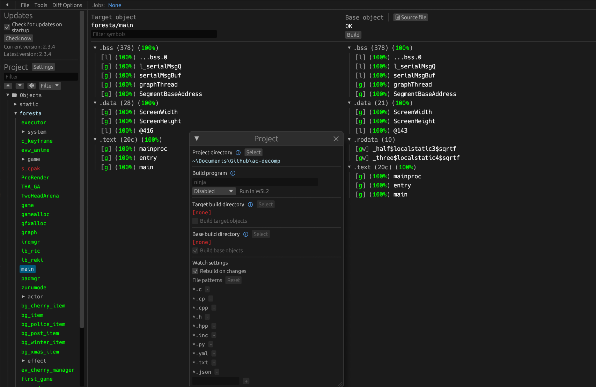

Animal Crossing  
[![Build Status]][actions] [![DOL Progress]][Progress] [![REL Progress]][Progress] [![Discord Badge]][discord]
=============

[][Progress]

[Build Status]: https://github.com/Prakxo/ac-decomp/actions/workflows/build.yml/badge.svg
[actions]: https://github.com/Prakxo/ac-decomp/actions/workflows/build.yml
[Progress]: https://decomp.dev/ACreTeam/ac-decomp
[DOL Progress]: https://decomp.dev/ACReTeam/ac-decomp.svg?mode=shield&measure=code&category=dol&label=DOL
[REL Progress]: https://decomp.dev/ACReTeam/ac-decomp.svg?mode=shield&measure=code&category=modules&label=REL
[Discord Badge]: https://img.shields.io/discord/727908905392275526?color=%237289DA&logo=discord&logoColor=%23FFFFFF
[discord]: https://discord.gg/hKx3FJJgrV

A decompilation of Animal Crossing for the Nintendo GameCube.

This repository does **not** contain any game assets or assembly whatsoever. An existing copy of the game is required.

Supported versions:

- `GAFE01_00`: Rev 0 (USA)
- `GAFU01_00`: Rev 0 (Australia)
- `GAFP01_00`: Rev 0 (PAL - en, es, fr, it, de)

A decompilation of the original N64 version of the game is being worked on [here](https://github.com/zeldaret/af).

<!--
Quick Guides
============

- [Dumping Game Files](./docs/extract_game.md)
- [Ghidra Setup](./docs/ghidra_setup.md)
- [Generating Decomp Context](./docs/generating_decomp_context.md)
- [decomp.me Basics](./docs/decomp_me_basics.md)
- [Ghidra Basics](./docs/ghidra_basics.md)
- [m2c Basics](./docs/m2c_basics.md)
- [Decomp Basics](./docs/decomp_basics.md)
-->

Dependencies
============

Windows
--------

On Windows, it's **highly recommended** to use native tooling. WSL or msys2 are **not** required.  
When running under WSL, [objdiff](#diffing) is unable to get filesystem notifications for automatic rebuilds.

- Install [Python](https://www.python.org/downloads/) and add it to `%PATH%`.
  - Also available from the [Windows Store](https://apps.microsoft.com/store/detail/python-311/9NRWMJP3717K).
- Download [ninja](https://github.com/ninja-build/ninja/releases) and add it to `%PATH%`.
  - Quick install via pip: `pip install ninja`

macOS
------

- Install [ninja](https://github.com/ninja-build/ninja/wiki/Pre-built-Ninja-packages):

  ```sh
  brew install ninja
  ```

- Install [wine-crossover](https://github.com/Gcenx/homebrew-wine):

  ```sh
  brew install --cask --no-quarantine gcenx/wine/wine-crossover
  ```

After OS upgrades, if macOS complains about `Wine Crossover.app` being unverified, you can unquarantine it using:

```sh
sudo xattr -rd com.apple.quarantine '/Applications/Wine Crossover.app'
```

Linux
------

- Install [ninja](https://github.com/ninja-build/ninja/wiki/Pre-built-Ninja-packages).
- For non-x86(_64) platforms: Install wine from your package manager.
  - For x86(_64), [wibo](https://github.com/decompals/wibo), a minimal 32-bit Windows binary wrapper, will be automatically downloaded and used.

Building
========

- Clone the repository:

  ```sh
  git clone --recursive https://github.com/Prakxo/ac-decomp.git
  ```

- Update and Initialize submodules:

  ```sh
  git submodule update --init --recursive
  ```

- Copy your game's disc image to `orig/GAFE01_00`.
  - Supported formats: ISO (GCM), RVZ, WIA, WBFS, CISO, GCZ

- Configure:

  ```sh
  python configure.py
  ```

  To use a version other than `GAFE01_00` (USA), specify it with `--version`.

  Stock compilers with the external SJIS wrapper are the default. To use optimized
  GC 1.3.2f1 or 2.6f1 with built-in SJIS conversion, add `--fast-mwcc`, for example
  `python configure.py --version GAFE01_00 --fast-mwcc` for US or
  `python configure.py --version GAFU01_00 --fast-mwcc` for Australia.
  This uses the compiler set in `build/<version>/compilers` (including `GC/1.3.2f1`
  or `GC/2.6f1`), or the directory specified by `--compilers`.
  Other compiler versions are unaffected.
  Omit `--fast-mwcc` when configuring to return to stock.
  The f1 compiler builds are unreleased modifications,
  so most users should stick to stock compilers.

  PAL has five language targets. Extract each language TGC into
  `orig/GAFP01_00_en`, `orig/GAFP01_00_fr`, `orig/GAFP01_00_de`,
  `orig/GAFP01_00_it`, or `orig/GAFP01_00_es`, then configure with:

  ```sh
  python configure.py --version GAFP01_00 --language en
  ```

  `--version GAFP01_00_en` selects the same target. Replace `en` with `fr`,
  `de`, `it`, or `es` for the other languages. All PAL targets use `VERSION=2`
  and their corresponding `GAME_LANGUAGE` value. Each has separate build outputs,
  symbols, splits, progress, and hashes for its DOL and four RELs (`foresta`,
  `forestd`, `foresti`, and `foresto`). Matching PAL sources are shared across
  languages; unmatched units still use original split objects. TGC rebuilding
  is not included.

  PAL comparison targets prefer Australian sources, falling back to shared US
  sources. The asset RELs have individual source splits and module-specific
  extraction directories. Sources that still need a PAL port are listed in
  `tools/pal.py`; their source paths remain recorded, while comparisons and
  `all_source` wait until they compile. Only verified PAL objects are linked.

  PAL source and header overrides mirror the base paths under `src/PAL/`
  and `include/PAL/`. PAL include directories are searched before the shared
  Australian/US directories for every PAL object.

- Build:

  ```sh
  ninja
  ```

Diffing
=======

Once the initial build succeeds, an `objdiff.json` should exist in the project root.

Download the latest release from [encounter/objdiff](https://github.com/encounter/objdiff). Under project settings, set `Project directory`. The configuration should be loaded automatically.

Select an object from the left sidebar to begin diffing. Changes to the project will rebuild automatically: changes to source files, headers, `configure.py`, `splits.txt` or `symbols.txt`.



License
=======
This project's source code and most of its tools are made available under the [Creative Commons Zero 1.0](https://github.com/ACreTeam/ac-decomp/blob/master/LICENSE) license. However, the following included tools use different licenses:

pyjkernel is made available under the [GPLv3](https://github.com/ACreTeam/ac-decomp/blob/master/tools/pyjkernel/LICENSE) license.

ninja_syntax is made available under the [Apache 2.0](http://www.apache.org/licenses/LICENSE-2.0) license.

Credits
=======

- jamchamb, Cuyler36, NWPlayer123 and fraser125 for past documentation of Animal Crossing.
- encounter and NWPlayer123 for [dtk-template](https://github.com/encounter/dtk-template) and setting up the current build system.
